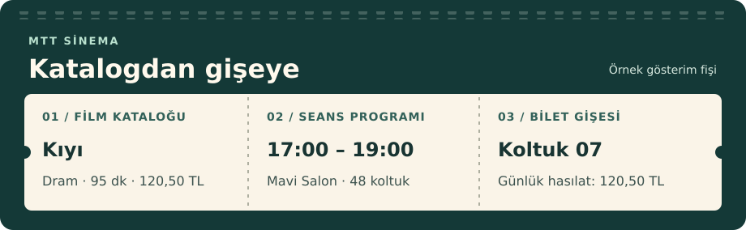

# MTT Sinema

Bir sinema salonunda film kataloğunu, gösterim programını ve bilet gişesini yönetmek için **C# / Windows Forms** masaüstü uygulaması. Kayıtlar bilgisayarınızda SQLite ile saklanır; ayrı bir veritabanı sunucusu gerekmez.



## Çalıştırma

1. Windows’ta **Visual Studio 2022**, **.NET masaüstü geliştirme** iş yükü ve **.NET Framework 4.7.2 hedefleme paketi** kurulu olmalı.
2. Depoyu klonlayın veya `MTT-Sinema.zip` kaynak paketini bir klasöre çıkarın. **`MttSinema.sln`** dosyasını açın.
3. NuGet paketlerini geri yükleyin (ilk derlemede internet gerekir). Başlangıç projesi **MttSinema** iken **F5** ile başlatın.

İlk açılışta boş bir veritabanı oluşturulur. ZIP, hazır EXE veya örnek müşteri verisi değil, derlenebilir kaynak proje içerir.

## İlk seansınızı planlayın

| Ekran | Deneyebileceğiniz işlem |
| --- | --- |
| **Film Kataloğu** | `Kıyı` adlı bir dram filmi ekleyin: **95 dakika**, **120,50 TL**. |
| **Salonlar** | `Mavi Salon` adında **48 koltuklu** bir salon tanımlayın. |
| **Saat Aralıkları** | **17:00–19:00** aralığını ekleyin. Saat aralıklarını farklı gün ve salonlarda tekrar kullanabilirsiniz. |
| **Seans Programı** | Gösterim tarihini, filmi, salonu ve aralığı seçip **Seans planla** düğmesine basın. |
| **Bilet Gişesi** | Aynı gün ve seansı seçip **7** numaralı koltuğa bilet satın. İptal için listeden bileti seçin. |
| **Günlük Rapor** | Gösterim gününü seçin: bu örnekte **1 bilet**, **%2,1 doluluk** ve **120,50 TL hasılat** görünür. |

## Veriler ve yedekleme

Veritabanı **`%LOCALAPPDATA%\MttSinema\sinema.db`** dosyasıdır. Yedeklemek için uygulamanın **tüm açık kopyalarını kapatın**, ardından bu dosyayı kopyalayın. Geri yüklerken de uygulama kapalı olmalı; mevcut dosyanızı değiştirmeden önce ayrı bir kopyasını alın. Eski sürüm kayıtları yalnızca bellekte tutuyordu; aktarılması gereken eski bir veritabanı yoktur.

- Aynı salonda aynı gün kesişen seanslar engellenir. Biri bittiği anda diğeri başlayabilir. Film seçilen aralığa sığmalı; gece yarısını aşan aralıklar desteklenmez.
- Koltuk numarası seans başına benzersizdir ve salon kapasitesini aşamaz. Bir seansın bileti dururken seans; seans dururken bağlı film, salon veya saat aralığı silinemez.
- Fiyatlar **tam sayı kuruş** olarak tutulur. Film fiyatını değiştirmek önceki biletlerin hasılatını değiştirmez. İptal, koltuğu yeniden satışa açar ve bedeli gösterim gününün raporundan düşer.

Tablolar, ilişkiler ve denetimler [sürümlü SQLite şemasında](src/MttSinema/Veri/Sema.sql); parametreli sorgular [veri katmanındadır](src/MttSinema/Veri/SinemaDeposu.cs).

## Derleme ve doğrulama

Visual Studio **Developer PowerShell** içinde, çözümün bulunduğu klasörden:

```powershell
msbuild MttSinema.sln -restore -p:Configuration=Release
.\tests\MttSinema.Testler\bin\Release\net472\MttSinema.Testler.exe
```

Masaüstü çıktısı `src\MttSinema\bin\Release\` altında oluşur; uygulamayı taşırken yalnız EXE’yi değil bağımlılıklarıyla birlikte klasörü alın. Entegrasyon testi geçici bir veritabanında planlama, satış, iptal, fiyat değişikliği ve yeniden açılışı sınar; kişisel veritabanınıza dokunmaz.

İsteğe bağlı **Python 3.11+** komutları (şema testi için SQLite 3.37+):

```text
python -m unittest discover -s tests -p "test_*.py"
python araclar/paketle.py
python araclar/paketle.py --kontrol
```

Paketleme komutu kaynakları, testleri ve bu kılavuzu `MTT-Sinema.zip` içinde toplar. `--kontrol` paketi yeniden yazmadan içeriğini çalışma ağacıyla karşılaştırır. `.vs`, `bin`, `obj` ve yerel veritabanı pakete girmez.
